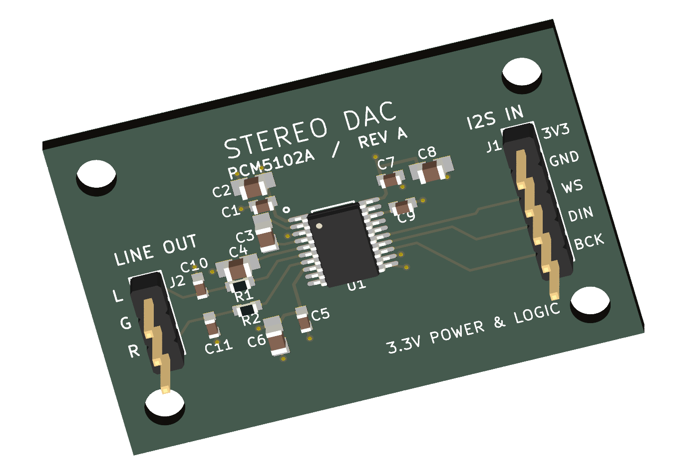

# PCM5102A stereo audio DAC · Rev A

[Download the complete tscircuit project and JLCPCB manufacturing files](audio-dac-rev-a.zip).

The 42 × 28 mm four-layer board takes regulated 3.3 V and a three-wire I²S input. It provides left and right line outputs through 470 Ω / 2.2 nF filters. The PCM5102APWR is JLCPCB part C107671.

The ZIP contains the editable tscircuit React project, imported JLCPCB footprints, schematic, filled KiCad PCB, Gerbers and drills, BOM, CPL, and bring-up instructions. KiCad reported zero design-rule violations and zero unconnected pads. Physical fabrication and bench testing are pending.

For a bare-board order, upload `manufacturing/JLCPCB-Gerbers.zip` from the archive and select four layers, 1.6 mm FR-4. The supplied BOM and CPL cover the top-side SMT parts. J1 and J2 are through-hole headers for hand soldering.
