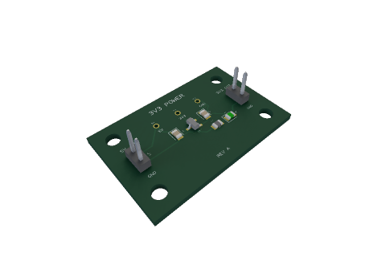

# 3.3 V power board

Rev A is a 38 × 24 mm, two-layer, 1.6 mm FR-4 prototype. It converts a regulated 5 V input to 3.3 V for a small sensor or microcontroller. The LED indicates that the 3.3 V rail is energized. Four 3.2 mm unplated holes fit M3 mounting hardware on a 30 × 16 mm pattern.



[PCB layout](pcb.svg) · [Schematic](schematic.svg) · [Gerber and drill files](gerbers.zip)

## Connections

| Reference | Connection |
| --- | --- |
| J1 | Pin 1 = regulated 5 V input. Pin 2 = GND. |
| J2 | Pin 1 = regulated 3.3 V output. Pin 2 = GND. |
| TP1 | 5 V input |
| TP2 | 3.3 V output |
| TP3 | GND |

The square pad identifies pin 1 on each header. The two header positions share a ground. Probe the three exposed plated test pads directly. Install D1 with its cathode toward the **K** mark.

## Parts

| Reference | Qty. | Part number | Description |
| --- | ---: | --- | --- |
| U1 | 1 | Microchip MCP1700-3302E/TT | 3.3 V LDO, SOT-23 |
| C1, C2 | 2 | Murata GRM21BR71C225KA12L | 2.2 µF, 16 V, X7R, 0805 |
| R1 | 1 | Yageo RC0805FR-071KL | 1 kΩ, 1%, 0805 |
| D1 | 1 | Lite-On LTST-C170KGKT | Green LED, 0805 |
| J1, J2 | 2 | Würth Elektronik 61300211121 | 2-position, 2.54 mm through-hole header |

See the [MCP1700 datasheet](https://www.microchip.com/content/dam/mchp/documents/APID/ProductDocuments/DataSheets/MCP1700-Data-Sheet-20001826F.pdf) for pin assignments, capacitor requirements, and thermal limits.

## Build

Install Node.js and Bun. From this directory, run:

```sh
npm ci
npm run check
npm run build
npm run export:gerbers
```

The tscircuit source is `index.tsx`. The build writes Circuit JSON and schematic, PCB, and 3D previews to `dist/index/`. The export writes `dist/gerbers.zip`. The included manufacturing archive contains the bare-board layers and plated and unplated drill files.

## Bring-up

The initial load target is up to 100 mA at the nominal 5 V input. The LDO dissipates about 0.17 W at that load. The board has not been fabricated or bench-tested.

1. With power off, check the headers and test points for shorts.
2. Apply a current-limited 5 V supply to J1. Verify that D1 lights and that TP2 measures about 3.3 V relative to TP3.
3. Increase the load in steps up to 100 mA while monitoring output voltage and regulator temperature.
